~~~~

<div align="center">


# 小护康养 mini · 管理端前端

**Vue 3 + Element Plus + Vite** 构建的养老服务数字化管理平台 Web 端，基于 RuoYi-Vue3 v3.9.0 骨架二次开发。
一份前端代码，靠后端下发的动态路由同时支撑 **平台运营端** 与 **机构（门店）端** 两种角色视角。

[](LICENSE)
[](https://vuejs.org/)
[](https://vitejs.dev/)
[](https://element-plus.org/)
[](https://nodejs.org/)
[](https://gitee.com/y_project/RuoYi-Vue)

🐙 [GitHub](https://github.com/xiaohucare/xiaohucare-mini-vue) · 🚀 [Gitee](https://gitee.com/chongkelai/xiaohucare-mini-vue) · ⚙️ [后端仓库](https://github.com/xiaohucare/xiaohucare-mini) · 🏠 [官网](https://xiaohucare.github.io//)

</div>

> **💡 使用前请注意**：本仓库依赖配套的 Java 后端才能跑通登录与菜单；第三方 Key（天地图 / 萤石云）与示例截图均需使用者自行申请与确认，详见[安全与合规](#安全与合规)。

---

## 目录


| 🚀 快速上手                                                                                                                                                                 | 🧩 二次开发                                                                                                                                                                                                                              |
| --------------------------------------------------------------------------------------------------------------------------------------------------------------------------- | ---------------------------------------------------------------------------------------------------------------------------------------------------------------------------------------------------------------------------------------- |
| [项目简介](#项目简介)<br>[产品预览](#产品预览)<br>[技术栈](#技术栈)<br>[快速开始](#快速开始)<br>[环境变量](#环境变量)<br>[构建与部署](#构建与部署)<br>[常见问题](#常见问题) | [与后端的对应关系](#与后端的对应关系)<br>[目录结构](#目录结构)<br>[业务模块地图](#业务模块地图)<br>[开发约定](#开发约定)<br>[参与贡献](#参与贡献)<br>[安全与合规](#安全与合规)<br>[联系与支持](#联系与支持)<br>[致谢与许可](#致谢与许可) |

---

## 项目简介

`xiaohucare-mini-vue`（包名 `xiaohucare-mini-admin`，版本 `3.9.0`）面向中小型养老机构，覆盖「**预约 → 入住 → 照护 → 结算 → 退住**」全流程，并向外延伸出会员、合同、餐饮、库存、设备物联与数据可视化等模块。

**核心特性**

- 🧓 **康养主流程** —— 预约管理、到店登记、在住日程、离店交接与结算一站式闭环
- 🏢 **空间四级建模** —— 楼栋 / 楼层 / 房间 / 床位，含占用率可视化与机构端资料维护
- 📄 **电子合同** —— PDF 在线预览、签署区拖拽定位，支持平台通用模板与机构自建模板
- 💳 **会员与收费** —— 会员卡开卡 / 充值 / 消费、收费套餐、账单总览与离店结算
- 📡 **设备与安防** —— 定位设备、电子围栏、越界告警、轨迹回放、视频监控与设备台账
- 📊 **数据可视** —— ECharts 报表体系（长者统计、收费汇总、WMS 看板）与独立智慧园区大屏
- 🧭 **养老智慧台账** —— 巡访工单与主管部门汇总报表
- 🎪 **运营支撑** —— 活动发布与报名、食堂菜谱与订餐、站内消息与公告
- 🧱 **双端一体** —— 同一份前端，菜单与权限完全由后端动态下发
- 🌍 **国际化 & 权限** —— `zh` / `en` 语言包，跟随 `Accept-Language`；菜单级 + 按钮级权限

**适配角色**：平台运营方（多机构视角）· 养老机构（单店视角）· 二次开发者（学习 RuoYi 之上的业务改造方式）

---

## 产品预览

截图存放于 `docs/screenshots/`，命名规则为 `序号-模块.png`；均为 2x 屏截图，点击可打开原图。图中机构、人员与业务数据都是演示数据。

**首页工作台**

<p align="center">
  <a href="docs/screenshots/01-home-dashboard.png" target="_blank">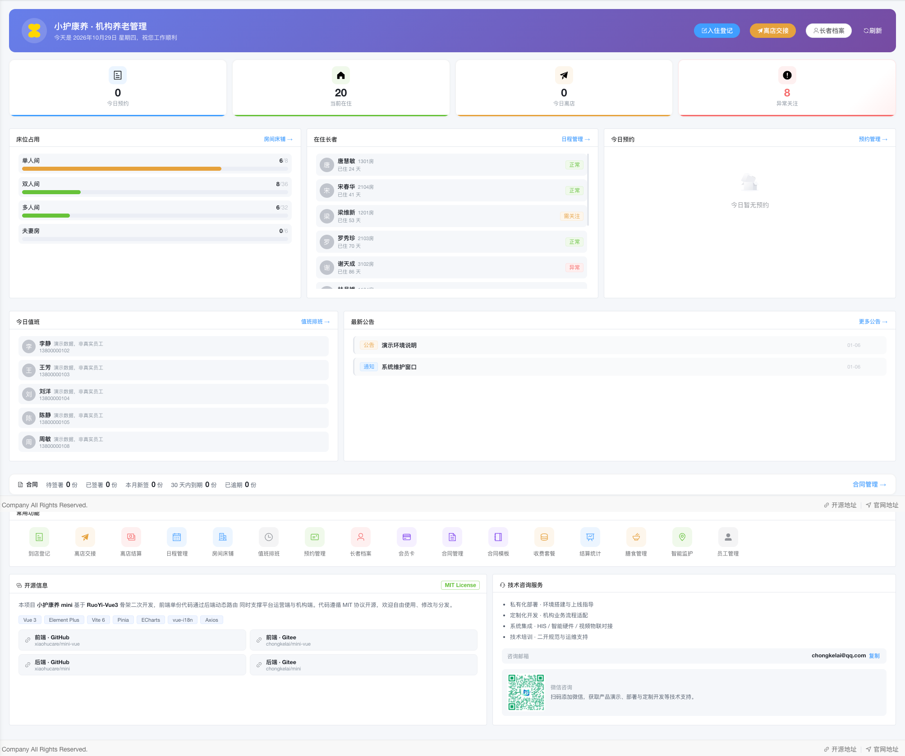</a>
  <br/><sub>入住概况 · 床位占用 · 在住长者 · 今日值班 · 公告 · 合同统计 · 常用功能 · 开源信息与咨询服务</sub>
</p>

**门户介绍页（`/index`，免登录）**

<p align="center">
  <a href="docs/screenshots/21-website.png" target="_blank">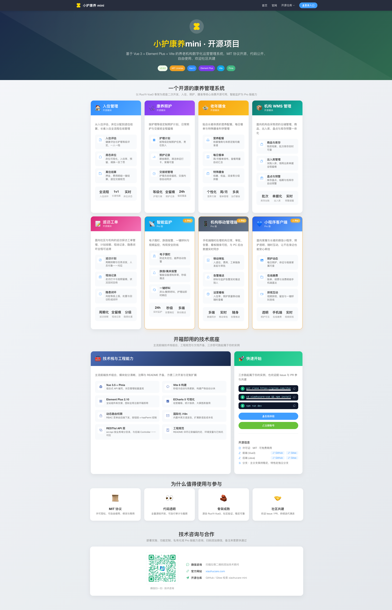</a>
  <br/><sub>开源项目主页，整页长图</sub>
</p>

### 概览与档案


|                                                     👵 长者统计分析<br><sub>核心指标卡与多维度分布图表</sub>                                                     |                                          🖥 智慧园区大屏<br><sub>独立可视化大屏，由主应用外链打开</sub>                                          |
| :--------------------------------------------------------------------------------------------------------------------------------------------------------------: | :----------------------------------------------------------------------------------------------------------------------------------------------: |
| <a href="docs/screenshots/03-resident-statistics.png" target="_blank">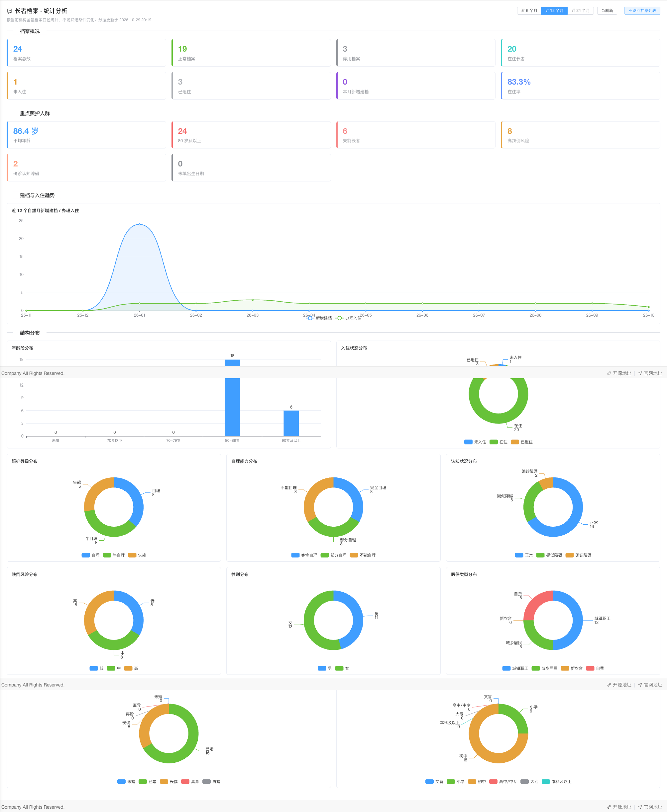</a> | <a href="docs/screenshots/22-park-screen.png" target="_blank">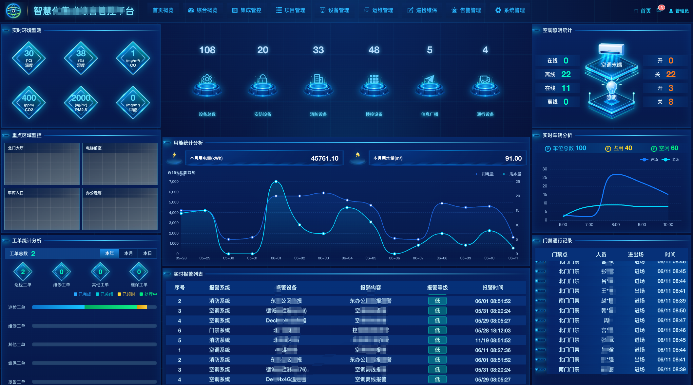</a> |
|                                                         👥 客户列表<br><sub>长者档案检索与建档维护</sub>                                                         |                                            💳 会员卡中心<br><sub>开卡 / 充值 / 消费 / 余额统计</sub>                                            |
|         <a href="docs/screenshots/02-resident-list.png" target="_blank">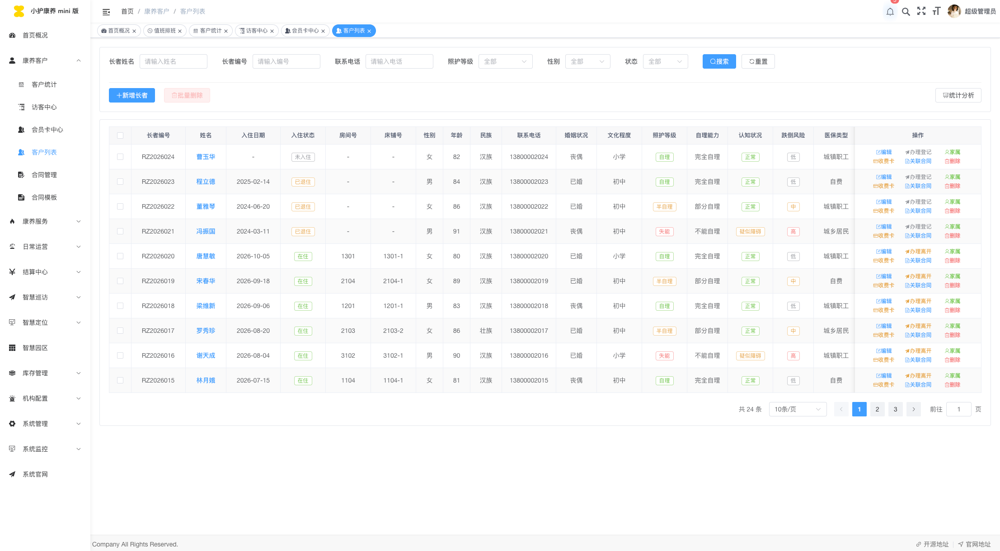</a>         |  <a href="docs/screenshots/04-member-card.png" target="_blank">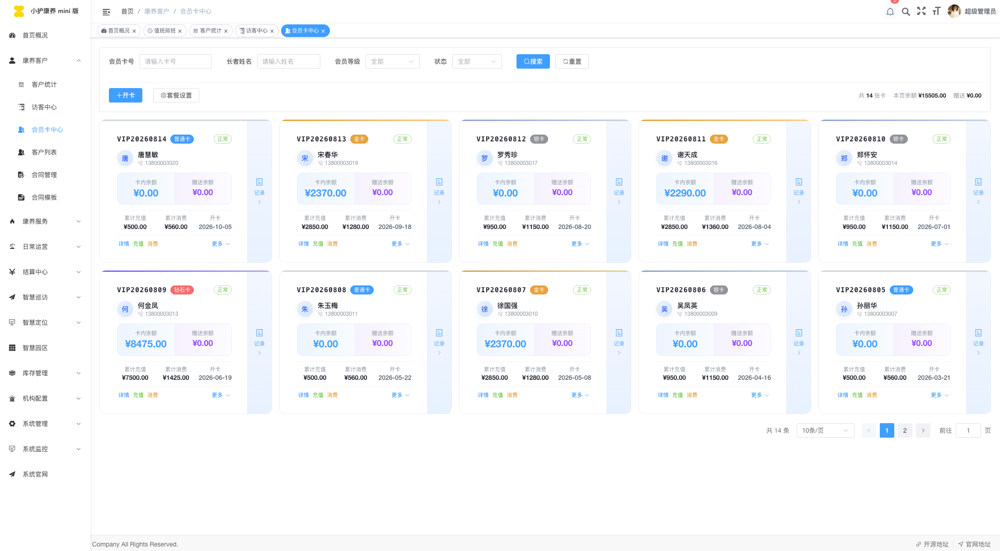</a>  |

### 合同与空间


|                                         📄 合同管理<br><sub>签署状态、PDF 预览与到期提醒</sub>                                         |                                                🧑‍🤝‍🧑 访客中心<br><sub>来访登记与通行记录</sub>                                                |
| :------------------------------------------------------------------------------------------------------------------------------------: | :------------------------------------------------------------------------------------------------------------------------------------------------: |
| <a href="docs/screenshots/06-contract.png" target="_blank"></a> | <a href="docs/screenshots/05-visitor-center.png" target="_blank">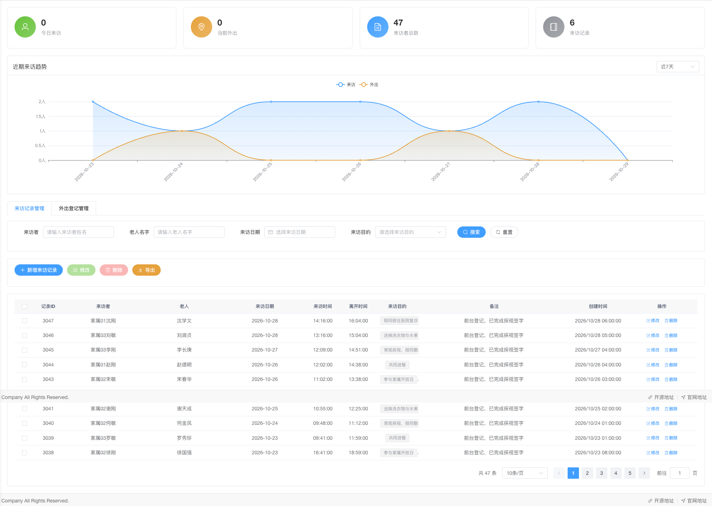</a> |
|                                      🛏 房间床铺<br><sub>楼栋 / 楼层 / 房间 / 床位四级视图</sub>                                      |                                                 🏢 房间管理<br><sub>机构配置中的空间资料维护</sub>                                                 |
| <a href="docs/screenshots/07-room-bed.png" target="_blank"></a> |    <a href="docs/screenshots/20-room-manage.png" target="_blank">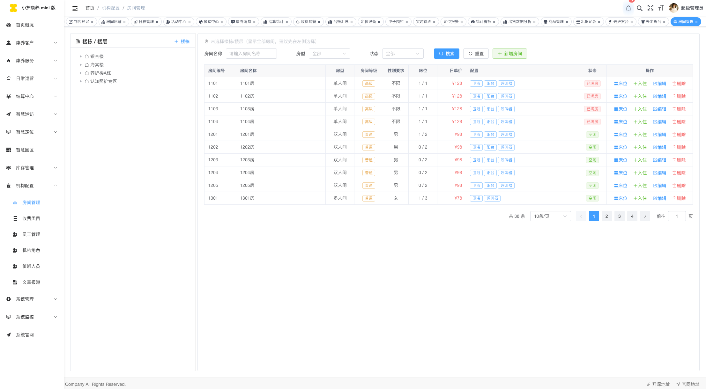</a>    |

### 运营与照护


|                                               📅 日程管理<br><sub>在住长者的照护日程（整页长图）</sub>                                               |                                                   🕐 值班排班<br><sub>按周排班与当班人员</sub>                                                   |
| :--------------------------------------------------------------------------------------------------------------------------------------------------: | :----------------------------------------------------------------------------------------------------------------------------------------------: |
|  <a href="docs/screenshots/08-daily-schedule.png" target="_blank">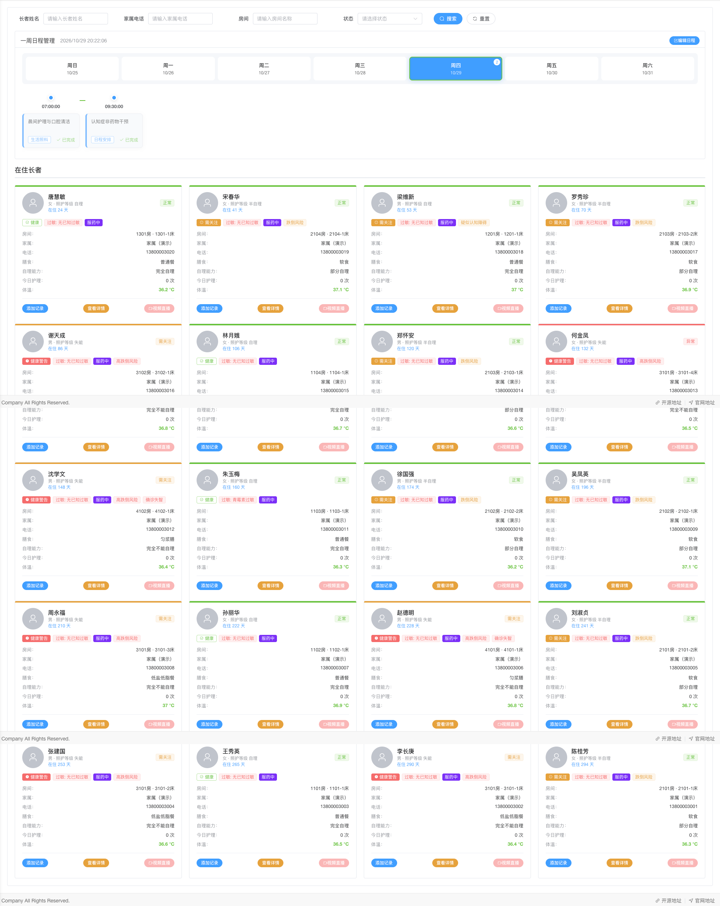</a>  | <a href="docs/screenshots/09-duty-schedule.png" target="_blank">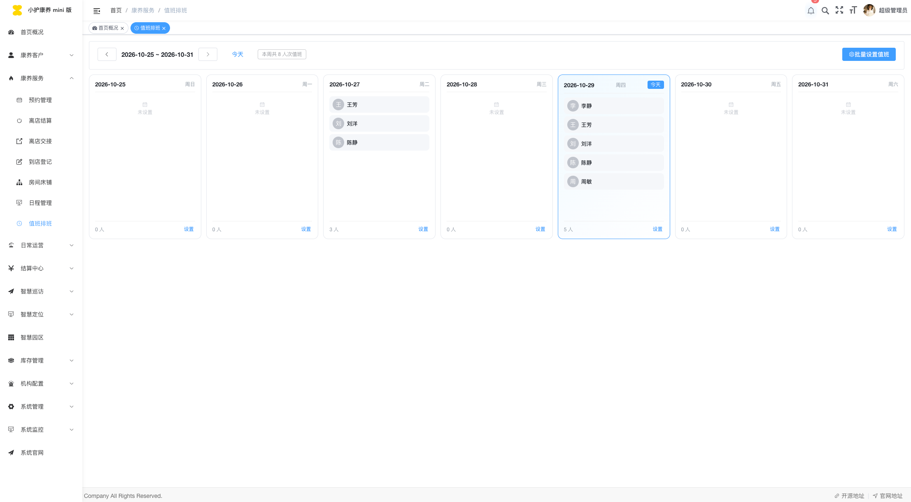</a> |
|                                                     🎪 活动中心<br><sub>活动发布与报名管理</sub>                                                     |                                                     🍚 食堂中心<br><sub>菜谱排期与订餐</sub>                                                     |
| <a href="docs/screenshots/11-activity-center.png" target="_blank">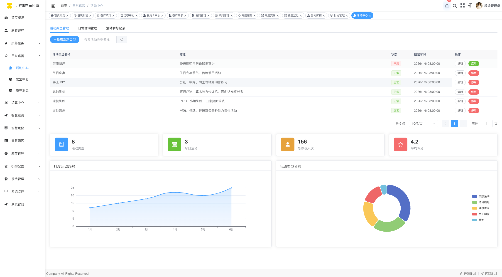</a> |   <a href="docs/screenshots/12-meal-center.png" target="_blank">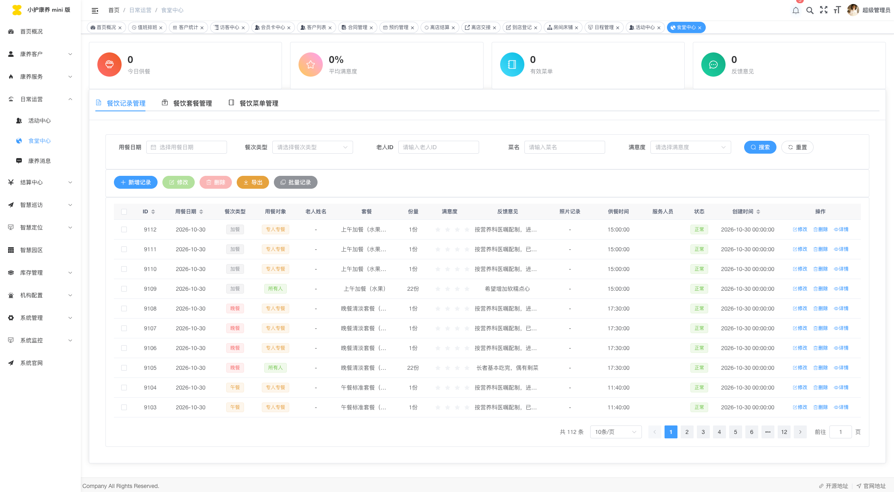</a>   |
|                                             🔔 康养消息<br><sub>站内通知列表，对应顶部消息中心抽屉</sub>                                             |                                                                                                                                                  |
|    <a href="docs/screenshots/13-care-message.png" target="_blank">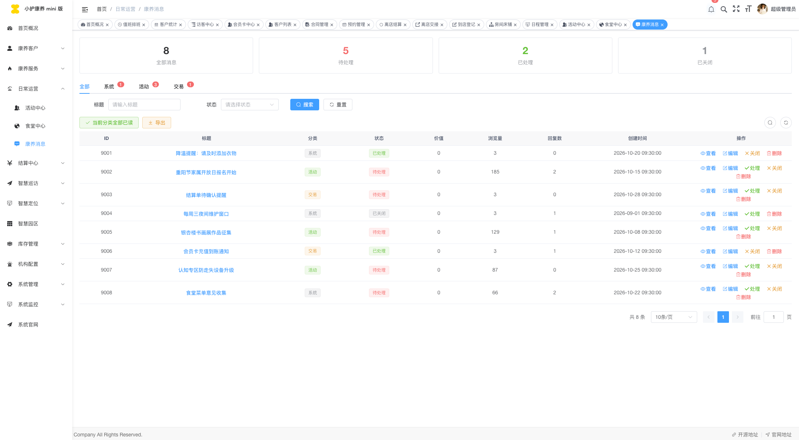</a>    |                                                                                                                                                  |

### 结算与台账


|                                                          🧾 离店结算<br><sub>费用明细与结算单</sub>                                                          |                                             💰 收费总览<br><sub>账单汇总与收缴情况（整页长图）</sub>                                             |
| :----------------------------------------------------------------------------------------------------------------------------------------------------------: | :----------------------------------------------------------------------------------------------------------------------------------------------: |
| <a href="docs/screenshots/10-checkout-settlement.png" target="_blank"></a> |  <a href="docs/screenshots/14-fee-overview.png" target="_blank">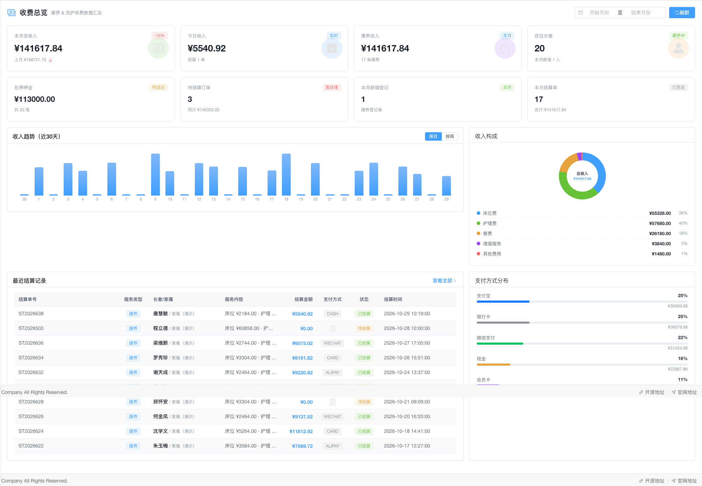</a>  |
|                                                           📦 收费套餐<br><sub>套餐与价格配置</sub>                                                           |                                              📑 汇总报表<br><sub>养老智慧台账报表（整页长图）</sub>                                              |
|         <a href="docs/screenshots/15-fee-package.png" target="_blank">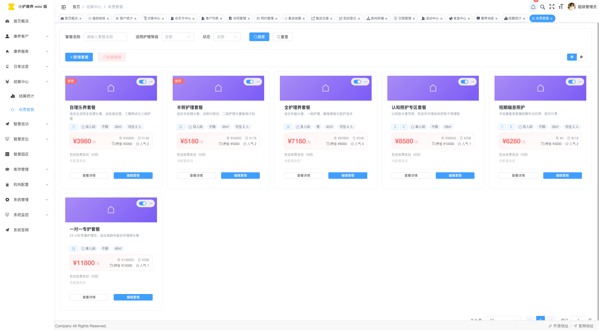</a>         | <a href="docs/screenshots/16-ledger-report.png" target="_blank">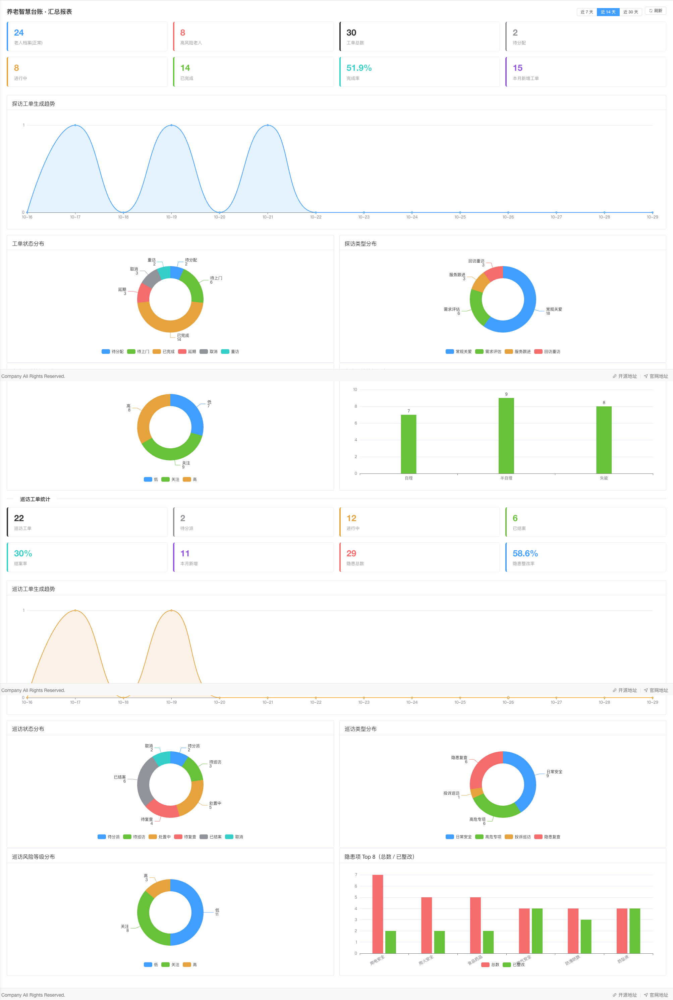</a> |

### 物联 · 库存


|                                             📡 定位报警<br><sub>定位设备、电子围栏与告警记录</sub>                                             |                                                  📈 库存看板<br><sub>WMS 出入库与库存统计</sub>                                                  |
| :--------------------------------------------------------------------------------------------------------------------------------------------: | :----------------------------------------------------------------------------------------------------------------------------------------------: |
|    <a href="docs/screenshots/17-gps-alarm.png" target="_blank">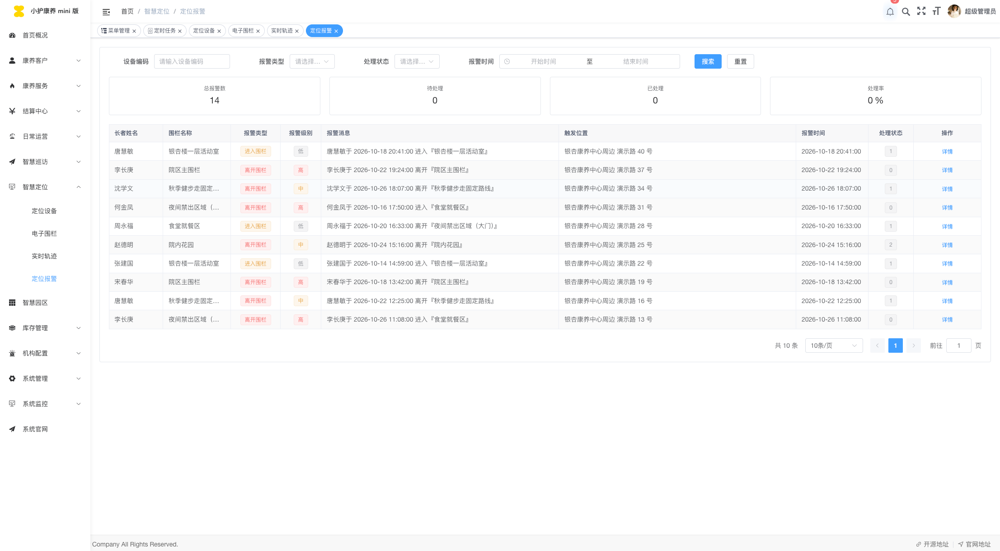</a>    | <a href="docs/screenshots/18-wms-dashboard.png" target="_blank"></a> |
|                                                🚚 出货分析<br><sub>出货数据统计与趋势分析</sub>                                                |                                                                                                                                                  |
| <a href="docs/screenshots/19-wms-shipping.png" target="_blank">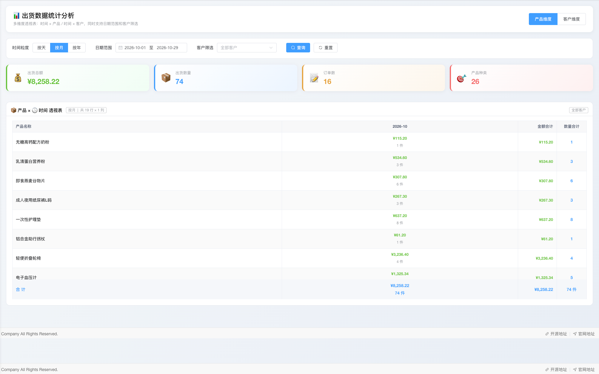</a> |                                                                                                                                                  |

---

## 技术栈


| 能力        | 依赖（版本取自`package.json`）                                                                               |
| ----------- | ------------------------------------------------------------------------------------------------------------ |
| 框架        | `vue` 3.5.16、`vue-router` 4.5.1、`pinia` 3.0.2                                                              |
| UI          | `element-plus` 2.10.7、`@element-plus/icons-vue` 2.3.1                                                       |
| 构建        | `vite` 6.3.5、`@vitejs/plugin-vue` 5.2.4、`sass-embedded` 1.89.1                                             |
| 请求        | `axios` 1.9.0（封装在 `src/utils/request.js`）                                                               |
| 图表        | `echarts` 5.6.0、`vue-echarts` 6.6.0、`echarts-liquidfill` 3.1.0                                             |
| PDF         | `pdfjs-dist` 3.11.174、`vue-pdf-embed` 2.1.1（合同在线预览 / 签署区拖拽）                                    |
| 布局        | `splitpanes` 4.0.4（可拖分栏）、`vuedraggable` 4.1.0                                                         |
| 富文本      | `@wangeditor/editor` 5.1.23、`@vueup/vue-quill` 1.2.0（`overrides` 锁定 quill 2.0.2）                        |
| 国际化      | `vue-i18n` 9.14.5（`src/i18n/langs/zh.js`、`en.js`）                                                         |
| 视频 / 物联 | `ezuikit-js`（萤石云直播）、`@liveqing/liveplayer-v3`                                                        |
| 其他        | `js-cookie`、`jsencrypt`（登录密码加密）、`nprogress`、`fuse.js`（搜索）、`file-saver`、`@vueuse/core`       |
| Vite 插件   | `unplugin-auto-import`、`unplugin-vue-setup-extend-plus`、`vite-plugin-svg-icons`、`vite-plugin-compression` |

> **💡 提示**：`unplugin-auto-import` 已自动导入 `vue` / `vue-router` / `pinia` 的常用 API，仓内多数页面仍显式 `import { ref } from 'vue'` —— 两种写法都合法，改现有文件时**跟随上下文风格**即可。

---

## 快速开始

### 环境要求


| 项目     | 要求                                                                |
| -------- | ------------------------------------------------------------------- |
| Node.js  | **≥ 18**（Vite 6 的硬性要求，`package.json` 已声明 `engines`）     |
| 包管理器 | npm（锁文件为`package-lock.json`；pnpm / yarn 亦可）                |
| 后端服务 | 需先启动配套 Java 后端，默认`http://localhost:8187/xiaohucare-api/` |
| 浏览器   | Chrome / Edge 近两年版本；IE 会跳转`html/ie.html` 提示页            |

### 启动

```bash
# 1. 安装依赖（国内建议换源）
npm install --registry=https://registry.npmmirror.com

# 2. 配置第三方 Key（可选，不配则地图与视频不可用）
#    .env.development 中填入 VITE_TDT_KEY / VITE_YS_ACCESS_TOKEN

# 3. 启动开发服务器，访问 http://localhost:80
npm run dev
```

> **⚠️ 注意**：登录账号、角色与菜单均由后端初始化数据提供，本仓库不含账号；菜单为空请先在后台给角色分配菜单。

### 可用命令


| 命令                  | 说明                                             |
| --------------------- | ------------------------------------------------ |
| `npm run dev`         | 开发服务器，端口固定`80`，自动打开浏览器         |
| `npm run build`       | 生产构建，产物在`dist/`                          |
| `npm run build:prod`  | 等价于`build`（同一份 `vite build`）             |
| `npm run build:stage` | `vite build --mode staging`，读取 `.env.staging` |
| `npm run preview`     | 本地预览`dist/`                                  |

构建压缩默认**关闭**：`vite/plugins/compression.js` 只在 `VITE_BUILD_COMPRESS` 存在时启用，支持 `gzip`、`brotli`（逗号分隔）。需要时在 env 文件加 `VITE_BUILD_COMPRESS = 'gzip'`。

`bin/*.bat` 是 Windows 一键安装 / 构建 / 启动脚本，仅供便捷使用。

---

## 环境变量

新增环境变量必须以 `VITE_` 开头才能在客户端代码中读到。三份 env 文件：`.env.development`、`.env.staging`、`.env.production`。


| 变量                    | development                             | staging      | production              | 说明                                           |
| ----------------------- | --------------------------------------- | ------------ | ----------------------- | ---------------------------------------------- |
| `VITE_APP_TITLE`        | 小护康养 mini 版                        | 同左         | 同左                    | 浏览器标题                                     |
| `VITE_APP_ENV`          | development                             | staging      | production              | 决定 vite`base`：生产 `/xiaohucare/`，其余 `/` |
| `VITE_APP_BASE_API`     | `/dev-api`                              | `/stage-api` | `/xiaohucare-api`       | axios`baseURL`，也是上传组件拼 `action` 的前缀 |
| `VITE_APP_PROXY_TARGET` | `http://localhost:8187/xiaohucare-api/` | 同左         | —（生产走 nginx 反代） | `vite.config.js` 开发代理目标                  |
| `VITE_TDT_KEY`          | 天地图 Key（默认空）                    | 空           | 空                      | 地图定位，需自行申请后填入                     |
| `VITE_YS_ACCESS_TOKEN`  | 萤石云 Token（默认空）                  | 空           | 空                      | 视频直播播放鉴权，需自行申请后填入             |

> **🔑 申请入口**：天地图 [https://console.tianditu.gov.cn/](https://console.tianditu.gov.cn/)、萤石开放平台 [https://open.ys7.com/](https://open.ys7.com/)。仓库内两者**已置空**，请勿复用他人凭据，也不要把填好的 `.env` 提交回仓库（本地覆盖请用 `.env.development.local`，已被 `.gitignore` 忽略）。

---

## 与后端的对应关系

本前端不承载业务逻辑，接口由配套的 Java 后端提供（默认端口 `8187`，上下文路径 `/xiaohucare-api`）。开发代理配置在 `vite.config.js`：

```js
const baseUrl = VITE_APP_PROXY_TARGET || 'http://localhost:8187/xiaohucare-api/'
'/dev-api'           → baseUrl，并 rewrite 去掉 /dev-api 前缀
'^/v3/api-docs/(.*)' → baseUrl                              // springdoc 在线接口文档
```

`src/api` 下接口按一级命名空间分布（按调用次数统计，可大致判断模块体量）：


| 命名空间          | 调用数 | 命名空间          | 调用数 |
| ----------------- | -----: | ----------------- | -----: |
| `/intra/care`     |    149 | `/intra/gps`      |     18 |
| `/intra/hotel`    |     81 | `/intra/alarm`    |     17 |
| `/intra/wms`      |     51 | `/intra/stat`     |     16 |
| `/intra/iot`      |     44 | `/intra/resident` |     16 |
| `/intra/config`   |     24 | `/intra/meal`     |     16 |
| `/intra/charge`   |     22 | `/intra/ginkgo`   |     13 |
| `/intra/activity` |      9 | —                |     — |

另有框架自带的 `/system/**`、`/monitor/**`、`/tool/**` 与通用上传 `/common/**`。

---

## 目录结构

```
xiaohucare-mini-vue/
├── index.html                 # 含首屏 loading 与 IE 降级跳转
├── vite.config.js             # base / 别名 @ ~ / 代理 / 打包分块
├── vite/plugins/              # auto-import、setup-extend、svg-icon、compression
├── nginx.conf                 # 二级目录部署示例（/xiaohucare/ + /xiaohucare-api）
├── html/ie.html               # 低版本浏览器提示页
├── docs/                      # 文档素材：screenshots 预览图、assets 图标与二维码
├── bin/                       # Windows 一键 package/build/run 脚本
└── src/
    ├── main.js                # 应用装配：全局方法、全局组件、图标、插件、指令
    ├── permission.js          # 路由守卫（登录态、动态路由、白名单）
    ├── settings.js            # 布局默认值（topNav/tagsView/fixedHeader/侧栏主题…）
    ├── api/                   # 接口层，按业务域分目录，一文件对应一组后端 Controller
    ├── views/                 # 页面层，按业务域分目录（见「业务模块地图」）
    ├── components/            # 通用组件：Pagination/ImageUpload/FileUpload/ImagePreview/Editor/
    │                          #   DictTag/RightToolbar/TopNav/SvgIcon/IconSelect/CountTo/Crontab/
    │                          #   TimeFilter/EnergyUnitTree/PetHotel/YsPlayer（视频）/iFrame/RuoYi
    ├── layout/                # 框架外壳：Navbar（含消息中心抽屉）/Sidebar/TagsView/AppMain
    ├── store/modules/         # Pinia：user / permission / app / settings / dict / tagsView
    ├── router/index.js        # 常量路由；业务路由由后端菜单动态生成
    ├── utils/                 # request、auth、permission、ruoyi、dict、careEnums、tianditu、errorCode…
    ├── plugins/               # $modal / $tab / $auth / $cache / $download
    ├── directive/             # v-hasPermi、v-hasRole、v-copyText
    ├── composables/           # useI18n
    ├── i18n/                  # vue-i18n 实例与 zh/en 语言包
    └── assets/                # styles、icons/svg、images、fonts
```

---

## 业务模块地图


| `src/views` 目录                                  | 领域                                                                              | 对应接口目录                                                 |
| ------------------------------------------------- | --------------------------------------------------------------------------------- | ------------------------------------------------------------ |
| `store/`                                          | 机构端设置：基本资料、员工、角色权限、空间（楼/层/房/床）、消息、文章、访客       | `api/store/*`、`api/care/*`                                  |
| `resident/`                                       | 长者档案、会员卡片与长者统计分析                                                  | `api/residents.js`、`api/resident/*`                         |
| `customer/`                                       | 客户、会员卡、卡套餐（开卡 / 充值 / 消费 / 统计）                                 | `api/resident/residentCard.js`、`cardPackage.js`             |
| `contracts/`                                      | 合同管理与合同模板（平台通用 + 机构自建、模板 PDF 上传）                          | `api/contracts.js`                                           |
| `fee/`                                            | 收费、账单、结算                                                                  | `api/fee.js`、`api/care/billing.js`                          |
| `ledger/`                                         | 养老智慧台账与巡访工单                                                            | `api/care/ledger.js`                                         |
| `e_care/`                                         | 房间 / 入住 / 退住 / 日常安排 / 值班排班等康养主流程                              | `api/care/*`                                                 |
| `meals/`                                          | 餐饮与餐次计费                                                                    | `api/meals.js`                                               |
| `wms/`                                            | 库存物资与统计看板                                                                | `api/wms/*`、`api/inventory.js`                              |
| `devices/` `deviceState/`                         | 设备台账入口页、设备状态看板                                                      | `api/deviceState.js`、`api/devices.js`、`api/deviceManage/*` |
| `e_gps/` `video/`                                 | 定位设备 / 围栏 / 轨迹 / 围栏告警、视频监控                                       | `api/gps/*`、`api/video.js`                                  |
| `activities/`                                     | 活动与报名                                                                        | `api/activities.js`                                          |
| `system/` `monitor/` `tool/`                      | RuoYi 框架自带：用户 / 角色 / 菜单 / 字典 / 参数 / 日志、服务与缓存监控、代码生成 | `api/system/*`、`api/monitor/*`、`api/tool/*`                |
| `login.vue` `register.vue` `index.vue` `home.vue` | 登录注册、门户首页（开源介绍页）、后台工作台                                      | `api/login.js`、`api/care/home.js`                           |

> **💡 改页面前的动线**：先按上表定位 `api` 文件 → 顺着接口 URL 找到后端实体 → **前端字段名必须与后端实体属性一致**。

---

## 开发约定

> 这一节是本仓库能长期维护的关键，**动手改代码前请务必读完**。

### 路由与权限

- 守卫在 `src/permission.js`：有 token 且 `roles` 为空时先 `getInfo()`，再 `generateRoutes()` 把后端菜单转成路由 `addRoute`。
- 登录后默认跳转 `/home`（工作台）；门户介绍页为 `/index`。
- 免登录白名单：`/login`、`/register`、`/404`、`/index`、`/website`。新增公开页要同步 `permission.js` 的 `whiteList`。
- 按钮级权限两种用法：
  - 指令：`v-hasPermi="['care:care:submit']"`、`v-hasRole`；
  - 函数：`import { checkPermi } from '@/utils/permission'` + `computed` + `v-if`。
- **多根节点（fragment）组件必须用 `v-if` 而不是 `v-hasPermi`**：指令作用在 fragment 根上不可靠，且组件挂载即发请求。

### 响应码约定

`request.js` 响应拦截器：`const code = res.data.code || 200`，即：

- 未返回 `code` 或 `code = 0`（falsy）都归一为 `200`，请求正常 `resolve(res.data)`。
- `401` 弹「会话过期」确认后 `logOut()` 并跳 `${import.meta.env.BASE_URL}index`；`500` 弹错误、`601` 弹警告，其余非 `200` 走 `ElNotification.error`。
- 页面里判断成功统一用 `res.code === 0` 或直接读 `res.data`。

### 请求拦截器行为

- `baseURL = VITE_APP_BASE_API`，超时 `10000ms`，自动带 `Authorization: Bearer <token>` 与 `Accept-Language`。
- GET 的 `params` 会被 `tansParams` 拼进 URL（数组 / 嵌套对象自动展开）。
- POST/PUT **1 秒内同 URL 同 body 会被判为重复提交并 reject**。需要绕过时设置 `headers: { repeatSubmit: false }`。
- `responseType` 为 `blob` / `arraybuffer` 时直接透传；导出走 `download()` / `$download`。
- 部署子路径统一靠 `import.meta.env.BASE_URL`（由 vite `base` 注入）：`router/index.js` 的 `createWebHistory`、`request.js` 的 401 跳转均已读取它，**不要再写死 `/xiaohucare/` 或 `/`**。

### 编码风格与已知坑

- **枚举列集中在 `src/utils/careEnums.js`**：由 enum 升级为 tinyint 的编码列（餐次、合同状态、照护等级等）在此统一维护「取值 / 下拉选项 / 名称映射 / 标签样式」，不要在页面里重复定义 `[{value,label}]`。
- 后端实体是命名的唯一来源，字段用 camelCase 对应列的 snake_case；提交表单时**先解构剔除纯控件字段**再发请求。
- 表单重置用 `clearValidate()` 而非 `resetFields()`（后者会回滚到组件挂载时的初值，动态表单上会"复活"旧数据）。
- `target="_blank"` 必须带 `rel="noopener"`。
- Element Plus 图标已由 `main.js` 全量注册，模板里可直接写 `<Document />`、`<Plus />`，无需 import。

---

## 构建与部署

`npm run build` 的关键产物约定（来自 `vite.config.js`）：

- `base` 为 `/xiaohucare/`（因 `VITE_APP_ENV === 'production'`），即应用部署在**二级目录**下；改部署路径只需改 `vite.config.js` 的 `base`，代码侧通过 `import.meta.env.BASE_URL` 读取。
- 输出：`dist/`，js/css/图片分别落到 `static/js`、`static/css`、`static/[ext]`；`sourcemap` 构建时关闭。
- 生产构建通过 `esbuild.drop` 移除 `console` / `debugger`。
- `pdfjs-dist` 的 worker 通过 `manualChunks` 单独打块，并配置了 `dedupe: ['pdfjs-dist']` —— **不要随意删除这两处**，否则合同 PDF 预览会报 worker 加载失败。
- `chunkSizeWarningLimit` 提到 2000，构建时仍可能提示大 chunk，属预期。

生产侧 nginx 需满足两条：静态资源命中 `/xiaohucare/`，并把 `VITE_APP_BASE_API`（`/xiaohucare-api`）反代到后端 `8187` 且**去掉前缀**。可参考仓库根目录的 `nginx.conf` 示例（域名与后端地址已置为占位，请按实际环境替换）。

---

## 常见问题


| 现象                       | 原因与处理                                                             |
| -------------------------- | ---------------------------------------------------------------------- |
| 启动报端口占用             | 开发端口固定`80`，改 `vite.config.js` 的 `server.port`                 |
| 接口全部 404               | `VITE_APP_PROXY_TARGET` 是否与后端实际地址 / 上下文路径一致            |
| 登录后菜单空白             | 菜单由后端下发，先确认角色已分配菜单                                   |
| PDF 预览白屏 / worker 报错 | [构建与部署](#构建与部署)中的 `manualChunks` 与 `dedupe` 被删改所致    |
| 提交被拒"请勿重复提交"     | 1 秒内重复点击，属拦截器保护；必要时关`repeatSubmit`                   |
| 打包后子目录刷新 404       | nginx 未配`try_files ... /xiaohucare/index.html` 回退                  |
| 地图 / 视频不显示          | `VITE_TDT_KEY` / `VITE_YS_ACCESS_TOKEN` 未配置（仓库默认置空）         |
| 截图 / 图片加载不出来      | 相对路径基于仓库根，确认从`README.md` 所在层引用 `docs/screenshots/**` |

---

## 参与贡献

欢迎 Issue 与 PR 🎉

1. Fork 本仓库，从 `master` 切出特性分支：`git checkout -b feat/your-feature`
2. 改动前先读[开发约定](#开发约定)，遵循所在文件的既有风格（含是否显式 import）。
3. 新增业务模块时尽量成套提交：`src/api/xxx.js` + `src/views/xxx/` + 语言包 key；菜单与权限由后端配置，无需改前端路由。
4. 本仓库当前**未内置 ESLint 与单元测试**，PR 前请至少保证：
   ```bash
   npm run build          # 构建通过、无新增告警
   npm run dev            # 相关页面可正常打开与提交
   ```
5. Commit message 建议采用 `type(scope): subject`，常用 `type`：`feat` / `fix` / `style` / `refactor` / `docs` / `perf` / `build` / `chore`。
6. 提 PR 时说明：变更动机、影响范围、如何验证；涉及 UI 改动请附截图。

Bug 反馈请使用 Issue 模板并附上：复现步骤、浏览器与版本、控制台报错截图、`VITE_APP_ENV` 环境。

---

## 安全与合规

- **第三方 Key 自行申请**：`VITE_TDT_KEY`（天地图）、`VITE_YS_ACCESS_TOKEN`（萤石云）已在 `.env.*` 与源码中置空 / 改读环境变量，绝不复用他人凭据，也不要把填好凭据的 env 文件提交入库。
- **截图与数据**：`docs/screenshots/` 均为本地开发环境的演示数据。若你据此制作新截图并回馈仓库，请确认其中**不含真实长者身份、健康信息与费用数据**（本项目处理的是敏感个人信息）。
- **本地上传目录**：`src/assets/localoss/` 为运行时上传产物，已加入 `.gitignore` 并从仓库移除，请勿将真实业务文件提交入库。
- **部署信息**：`nginx.conf`、`vite.config.js` 中的域名 / 端口均为占位示例，请按实际环境替换。
- **漏洞报告**：涉及安全的敏感问题请勿直接公开 Issue，通过[联系与支持](#联系与支持)的邮箱私下反馈。

---

## 联系与支持

商业化落地或二次开发遇到阻塞，可以通过以下方式联系：


| 渠道             | 说明                                             |
| ---------------- | ------------------------------------------------ |
| 🐙 GitHub Issues | 缺陷反馈与功能建议（首选，便于公开沉淀）         |
| ✉️ 咨询邮箱    | [chongkelai#qq.com](mailto:chongkelai#qq.com)    |
| 💬 微信咨询      | 扫码添加，获取产品演示、部署与定制开发等技术支持 |

<p align="center">
  
</p>

**可提供的服务**：私有化部署与环境搭建指导 · 机构业务流程定制开发 · HIS / 智能硬件 / 视频物联系统集成 · 二开规范与运维培训。

---

## 致谢与许可

- 上游框架：[RuoYi-Vue3](https://gitee.com/y_project/RuoYi-Vue)（MIT）
- 依赖生态：[Vue](https://vuejs.org/)、[Element Plus](https://element-plus.org/)、[Vite](https://vitejs.dev/)、[ECharts](https://echarts.apache.org/)、[pdf.js](https://mozilla.github.io/pdf.js/)

本项目基于 RuoYi-Vue3（MIT）二次开发，`LICENSE` 保留上游版权声明并追加本项目版权，版本以 `package.json` 为准。

<div align="center">

如果这个项目对你有参考价值，欢迎点个 ⭐ Star。

</div>
